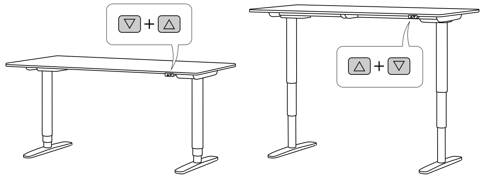

# BEKANT Firmware with standing/sitting memory positions

Control firmware for IKEA BEKANT adjustable-height desk with lower and upper
memory positions. Can be flashed onto the OEM controller, without changing any
hardware.

Pre-program a sitting and standing position for your desk and move between them
with a single button press.

This guide's primary focus is on the very affordable PICkit 3 programmer
(available on Aliexpress for little more than 10 €/USD + shipment), but gives
some hints on how to use PICkit 2 / 3 / 4 / 5 programmers on (as of writing
in 2026) current operating systems as well.

All you need:

1. said PICkit 3 programmer (~20 bucks)
2. patience and delicacy while opening the plastic case of the controller box
3. to have read the [Disclaimer](#disclaimer) below (**IMPORTANT!**)

## Button overview

| Button              | Action                                      |
| ------------------- | ------------------------------------------- |
| hold `△`            | move the desk up                            |
| hold `▽`            | move the desk down                          |
| hold `▽+△` for 3s   | save current position (auto-selected)       |
| hold `▽+△` for 8s   | factory reset (just keep pressed after 3s!) |
| press `△△` or `△+▽` | move to upper (standing) position           |
| press `▽▽` or `▽+△` | move to lower (sitting) position            |

Press a button during a memory move to cancel it (desk stops moving).

## (Re-)setting memory positions

After initial programming (or after each reset) the upper and lower memory
positions will be cleared (rather set to 0xffff), while the end-stop positions
(physical limits to where the motors may move the table) will be set to the
values retrieved given by the OEM firmware:

| Address | Value  | Role                                          |
| ------- | ------ | --------------------------------------------- |
| 0x00    | 0x0021 | OEM_BOTTOM_ENDSTOP — physical bottom end-stop |
| 0x02    | 0xffff | OEM_LOW_MEMORY — lower memory target          |
| 0x04    | 0xffff | OEM_HIGH_MEMORY — upper memory target         |
| 0x06    | 0x01d2 | OEM_TOP_ENDSTOP — physical top end-stop       |

At this point no memory re-call (move to upper/lower position) will work.

As soon as you save your first position, each re-call (upper or lower) will move
the table to that position (both stores will be set to the same value).

As soon as you save your second position, it will go into the upper or lower
memory position depending on whether the new position was bigger/smaller than
the one before.

Each consecutive save operation will store at the memory-slot which is closer to
the current position, making the whole operation quite intuitive.

## Installation

Ready to get it done? Follow these instructions:

- [Installation](INSTALL.md)
- [Testing](docs/TESTING.md)
- [Troubleshooting](docs/TROUBLESHOOTING.md)

## Disclaimer

**USE AT YOUR OWN RISK**

The original IKEA BEKANT firmware does not expose memory positions for safety
and liability reasons. The project by ivanwick preserves a small part of the
human-in-the-loop requirement as any button press cancels an automatic move. A
power cut will obviously do fine too. This fork sticks to the same pattern.

Whatever you do, keep in mind, that something could still go wrong in your
specific case. Therefor:

- Keep the desk's path clear during all movement.
- Stay near the controller while a memory move is in progress, so you can cancel
  by pressing any button or by plugging the main power cord.
- The firmware _is intended to_ drop the relay when the desk reaches the
  physical endstop, so the motor cannot stall indefinitely. This is implemented
  in `src/bekant/endstop.c` via a separate endstop-detector module, hopefully
  fixing the bug described in
  [ivanwick issue #4](https://github.com/ivanwick/bekantfirmware/issues/4).

## See also

- [License](LICENSE)
- [About this fork](docs/ABOUT.md)
- [Original project by ivanwick compared to fork by DieSteinhose](docs/COMPARISON.md)
- [State-machine traces](docs/TRACE.md)
- [End-stop analysis](docs/ENDSTOP_ANALYSIS.md)
- [reconstructed C code from OEM firmware disassembly](oem_reconstruction/)

## References

1. <a name="1">https://github.com/ivanwick/bekantfirmware</a>
2. <a name="2">https://web.archive.org/web/20190116092248/https://blog.rnix.de/hacking-ikea-bekant/</a>
3. <a name="3">https://github.com/trainman419/bekant</a>
4. <a name="4">https://github.com/robin7331/IKEA-Hackant</a>
5. <a name="5">https://github.com/diodenschein/TableMem</a>
6. <a name="5">https://en.wikipedia.org/wiki/Local_Interconnect_Network</a>
